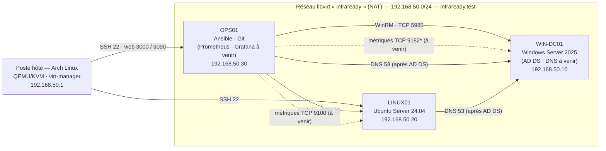

# Architecture (état courant)

*Mise à jour : séance 2. La version prévisionnelle de la séance 1 reste disponible dans
[`seance-01/03-architecture.md`](seance-01/03-architecture.md) et dans l'historique Git
(étiquette `v0.1-seance1`).*

Source modifiable : [`schemas/infraready-architecture.drawio`](schemas/infraready-architecture.drawio).

## Changements par rapport à la séance 1

| Changement | Écart |
|---|---|
| Hôte Arch Linux, hyperviseur QEMU/KVM (virt-manager) | E-01, E-02 |
| Réseau libvirt NAT avec passerelle 192.168.50.1 | E-03 |
| DNS temporaire 192.168.50.1 avant AD DS | E-04 |
| Flux WinRM OPS01 → WIN-DC01 (TCP 5985), limité à OPS01 | E-08 |
| RDP retiré (non activé) | E-09 |

Matrice des flux complète : [`securite.md`](securite.md).
