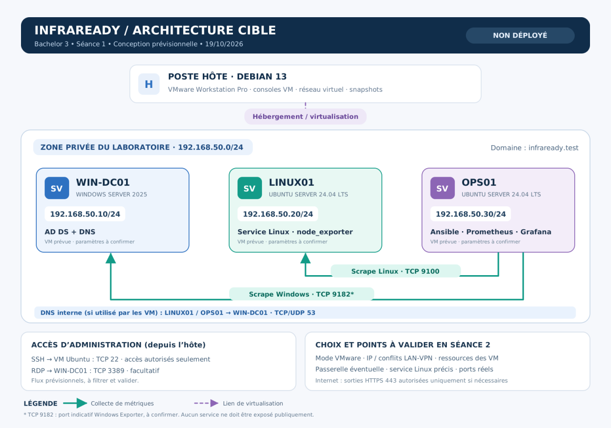

# Architecture technique — InfraReady

## 1. Présentation

Le projet InfraReady repose sur une infrastructure virtuelle composée de serveurs Linux et Windows.

L'objectif est de mettre en place un environnement permettant l'administration centralisée, l'automatisation des configurations et la supervision des systèmes.

L'infrastructure est hébergée sur un ordinateur Debian 13 utilisant VMware Workstation Pro.

**Statut : architecture prévisionnelle, non déployée.**

## 2. Machines virtuelles

| Machine | Système d'exploitation | Adresse IP | Rôle |
|---|---|---|---|
| WIN-DC01 | Windows Server 2025 | 192.168.50.10 | Active Directory et DNS |
| LINUX01 | Ubuntu Server 24.04 LTS | 192.168.50.20 | Services Linux et stockage |
| OPS01 | Ubuntu Server 24.04 LTS | 192.168.50.30 | Ansible, Prometheus et Grafana |

## 3. Ressources prévisionnelles

Les ressources suivantes sont proposées pour tenir compte des capacités du poste Debian 13.

| Machine | vCPU | RAM | Disque |
|---|---|---|---|
| WIN-DC01 | 2 | 4 Gio | 50 Go |
| LINUX01 | 2 | 2 Gio | 30 Go |
| OPS01 | 2 | 3 Gio | 50 Go |

Ces allocations restent à tester et à valider. La RAM proposée pour OPS01 est inférieure aux ressources indicatives du sujet.

## 4. Configuration réseau

- Réseau privé proposé : `192.168.50.0/24`
- Domaine Active Directory : `infraready.test`
- Serveur DNS prévu : `192.168.50.10`
- Adressage statique prévu pour les trois serveurs
- Passerelle : à définir uniquement si nécessaire

Le réseau virtuel devra permettre la communication entre les machines sans exposer inutilement les services sur le réseau extérieur.

## 5. Communications prévues

| Source | Destination | Protocole / port | Fonction |
|---|---|---|---|
| OPS01 | LINUX01 | TCP 9100 | Collecte des métriques Linux |
| OPS01 | WIN-DC01 | TCP 9182 | Collecte des métriques Windows, port à confirmer |
| LINUX01 / OPS01 | WIN-DC01 | TCP/UDP 53 | Résolution DNS |
| Poste hôte | VM Ubuntu | TCP 22 | Administration SSH |
| Poste hôte | WIN-DC01 | TCP 3389 | Administration RDP facultative |

Les flux devront être limités aux besoins réels de l'infrastructure.

## 6. Supervision

OPS01 hébergera Prometheus et Grafana.

Prometheus collectera les métriques à l'aide de Node Exporter sur LINUX01 et de Windows Exporter sur WIN-DC01.

Grafana permettra de visualiser notamment l'utilisation du processeur, de la mémoire, du stockage et la disponibilité des serveurs.

## 7. Sécurité

L'architecture prévoit :

- Un réseau de laboratoire privé.
- Des accès d'administration limités.
- Des règles de pare-feu adaptées aux flux autorisés.
- L'application du principe du moindre privilège.
- Des snapshots avant les changements importants.
- L'absence de secrets en clair dans GitHub.

## 8. Points restant à valider

- Compatibilité et configuration définitive du réseau VMware.
- Absence de conflit avec les réseaux existants.
- Confirmation des adresses IP.
- Ressources réellement nécessaires à chaque machine.
- Service applicatif à installer sur LINUX01.
- Configuration des ports et des pare-feu.
- Connectivité entre les machines.
- Résolution DNS.
- Fonctionnement des services.

## 9. Conclusion

Cette architecture constitue la base technique du projet InfraReady.

Elle permet de séparer les fonctions d'administration Windows, les services Linux et les outils de supervision.

Sa configuration et son fonctionnement devront être vérifiés lors des prochaines étapes du projet.
