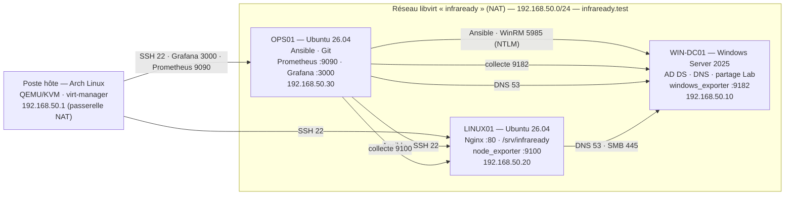

# Architecture (état courant)

*Mise à jour : séance 8. La version prévisionnelle de la séance 1 reste disponible dans
[`seance-01/03-architecture.md`](seance-01/03-architecture.md) et dans l'historique Git.*

Source modifiable : [`schemas/infraready-architecture.drawio`](schemas/infraready-architecture.drawio).

## Rôles et ressources

| Machine | Système | Disque système (mesuré) | Rôle |
|---|---|---|---|
| WIN-DC01 | Windows Server 2025 Standard | C: ≈ 50 Go (`S04_linux01_test-partage.txt`) | Contrôleur du domaine `infraready.test`, DNS, partage `Lab`, windows_exporter |
| LINUX01 | Ubuntu Server 26.04.1 LTS (E-12) | 20 Go + disque de données 5 Gio (`S04_linux01_disque-identification.txt`) | Nginx, volume `/srv/infraready`, node_exporter |
| OPS01 | Ubuntu Server 26.04.1 LTS (E-12) | ≈ 20 Go, groupe LVM de 18,22 Gio (`S05_ops01_extension-lv.txt`) | Contrôleur Ansible, clone Git, Prometheus, Grafana, node_exporter |

Aucune fusion de rôles : les trois VM du sujet sont présentes. vCPU et mémoire prévus : 2 vCPU par VM, 4 Go pour
WIN-DC01 et OPS01, 2 Go pour LINUX01 (1,6 Gio visibles, `S03_linux01_memoire.txt`) ; voir
[`seance-02/06-tableau-configuration.md`](seance-02/06-tableau-configuration.md).

**Adaptation aux ressources du poste hôte** : les disques de LINUX01 et OPS01 (20 Go) sont plus petits que les valeurs
indicatives du sujet (30 et 50 Go). L'installeur Ubuntu n'avait alloué que 10 Gio au volume racine d'OPS01 ; à 60 %
d'occupation, il a été étendu à chaud avec l'espace libre du groupe LVM (10 → 18,22 Gio, 33 % utilisés,
[`maintenance.md`](maintenance.md#6-gestion-de-la-capacité)). Le contrôle d'espace libre (15 %) de `verification.yml`
et l'alerte Prometheus surveillent cette marge.

## Dépendances principales

- **DNS** : LINUX01 et OPS01 résolvent via WIN-DC01 (192.168.50.10, suffixe `infraready.test`). Un arrêt de WIN-DC01
  coupe la résolution du domaine pour tout le labo : il est redémarré en dernier ([`maintenance.md`](maintenance.md)).
- **Automatisation** : tout part d'OPS01 (SSH vers LINUX01, WinRM vers WIN-DC01, exécution locale pour lui-même).
- **Supervision** : Prometheus (OPS01) tire les métriques des trois exporters ; Grafana interroge Prometheus en local.
- **Sortie Internet** : par la passerelle NAT de l'hôte (192.168.50.1), pour les mises à jour uniquement.

## Changements par rapport à la séance 1

| Changement | Écart |
|---|---|
| Hôte Arch Linux, hyperviseur QEMU/KVM (virt-manager) | E-01, E-02 |
| Réseau libvirt NAT avec passerelle 192.168.50.1 | E-03 |
| DNS temporaire 192.168.50.1 avant AD DS, puis 192.168.50.10 | E-04 |
| Ubuntu Server 26.04.1 LTS au lieu de 24.04 | E-12 |
| Flux WinRM OPS01 → WIN-DC01 (TCP 5985), limité à OPS01 | E-08 |
| RDP retiré (non activé) | E-09 |
| Pare-feu ufw sur LINUX01 et OPS01 (séance 8) | — |

Matrice des flux complète : [`securite.md`](securite.md#matrice-des-flux-état-séance-8).
