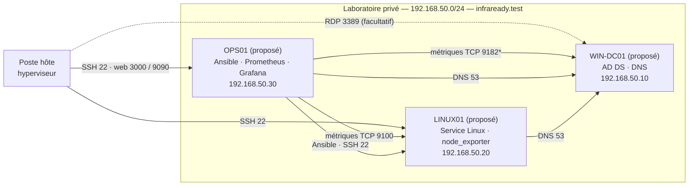

# Séance 1 — Étape 3 : architecture cible (prévisionnelle)

*Statut : **prévisionnel**, aucune VM installée. Date : 19/10/2026.*
*Les noms, adresses et ports sont des propositions à valider en séance 2.*

Références : support 1 (étape 3.3, fiche 2, exercice A), kit InfraReady (§2).

## Schéma

- Source modifiable : [`../schemas/infraready-architecture.drawio`](../schemas/infraready-architecture.drawio)
  (ouvrir avec draw.io / app.diagrams.net).
- Version lisible directement sur GitHub :

Légende : flèche = sens d'ouverture de la connexion (initiateur → service) ; pointillés = facultatif ;
`*` = port indicatif à confirmer. Le cadre « Laboratoire privé » est la **frontière du laboratoire** :
aucun service n'est publié vers le LAN ni vers Internet.

## Rôles envisagés

| Machine (nom proposé) | OS envisagé | Rôle |
|---|---|---|
| WIN-DC01 | Windows Server 2025 Evaluation (Desktop Experience) | AD DS, DNS du domaine `infraready.test` |
| LINUX01 | Ubuntu Server 24.04 LTS | Service Linux (à définir), node_exporter |
| OPS01 | Ubuntu Server 24.04 LTS | Administration et supervision : Ansible, Prometheus, Grafana |

Si les ressources de l'hôte sont insuffisantes, le rôle OPS01 peut être regroupé sur LINUX01
**après accord du formateur**, et le schéma comme l'inventaire seront alors mis à jour ensemble.

## Matrice des flux (fiche 2)

Seuls les flux justifiés par un besoin sont retenus.

| ID | Source | Destination | Protocole / port | Motif | Méthode de validation (séance 2+) |
|---|---|---|---|---|---|
| F1 | OPS01 | LINUX01 | TCP 9100 | Collecte des métriques (node_exporter) | `curl http://192.168.50.20:9100/metrics` depuis OPS01, cible `UP` |
| F2 | OPS01 | WIN-DC01 | TCP 9182 * | Collecte des métriques (windows_exporter) | `curl http://192.168.50.10:9182/metrics` depuis OPS01 |
| F3 | LINUX01, OPS01 | WIN-DC01 | TCP/UDP 53 | Résolution DNS du domaine | `getent hosts WIN-DC01.infraready.test` |
| F4 | Poste hôte | LINUX01, OPS01 | TCP 22 | Administration SSH | `ssh <compte>@<IP>` |
| F5 | Poste hôte | OPS01 | TCP 3000, 9090 | Accès web à Grafana et Prometheus | Ouverture de la page depuis le navigateur de l'hôte |
| F6 | Poste hôte | WIN-DC01 | TCP 3389 | Administration Windows graphique (**facultatif**) | Connexion RDP |
| F7 | OPS01 | LINUX01 | TCP 22 | Automatisation Ansible | `ansible linux -m ping` |

\* Le port réel de windows_exporter sera relevé dans la configuration installée (kit §13).

**Flux volontairement non tracés en séance 1 :** Grafana → Prometheus (même machine, `localhost`),
l'accès Internet pour les mises à jour (organisé en séance 2 selon les règles de l'établissement),
et les flux liés aux options du sujet (intégration d'Ubuntu à AD, Loki, runner auto-hébergé).

## Dépendances connues

- LINUX01 et OPS01 dépendent du **DNS de WIN-DC01** pour résoudre `infraready.test`.
- La **supervision** dépend de la disponibilité des exporters de LINUX01 et WIN-DC01.
- **Ansible** dépend de l'accès SSH d'OPS01 à LINUX01.
- Les trois VM dépendent du **poste hôte** et de son réseau virtuel.

## Hypothèses à valider en séance 2

| # | Hypothèse | Comment la valider |
|---|---|---|
| H1 | Mode réseau de l'hyperviseur : réseau privé isolé (Host-only / Custom ou équivalent) | Configuration du réseau virtuel relevée et documentée |
| H2 | Le plan 192.168.50.0/24 ne chevauche ni le LAN, ni un VPN, ni un réseau virtuel existant | `ip route` / `ip -br address` sur l'hôte |
| H3 | L'hôte dispose de RAM et de disque suffisants pour les trois VM | `free -h`, `df -h` sur l'hôte, plan de ressources |
| H4 | Les images d'installation officielles sont disponibles et vérifiées | ISO téléchargées depuis les sites officiels, somme SHA256 contrôlée |
| H5 | windows_exporter écoute sur TCP 9182 | Configuration réellement installée |

## Exercice A et fiche 2 — exporters et Internet

**Information donnée :** OPS01 collecte les métriques des exporters de LINUX01 (9100) et WIN-DC01 (9182).

**Pourquoi OPS01 doit les joindre :** Prometheus fonctionne en mode *pull* : c'est lui qui interroge
périodiquement chaque exporter. Sans ce flux, aucune métrique n'est collectée.

**Pourquoi les exporters ne doivent pas être accessibles depuis Internet :** ils publient sans
authentification des informations sur le système (versions, charge, disques, services, noms
d'interfaces), très utiles à un attaquant pour préparer une intrusion. Ils sont aussi une surface
d'attaque supplémentaire et une cible possible de déni de service. Seul OPS01 a besoin de les joindre :
c'est le principe du moindre privilège appliqué aux flux réseau.

**Hypothèse :** les exporters écouteront sur toutes les interfaces par défaut.
**Test futur :** depuis une machine autre qu'OPS01, la connexion au port 9100/9182 doit être refusée
une fois les règles de pare-feu en place ; depuis OPS01, elle doit réussir.
